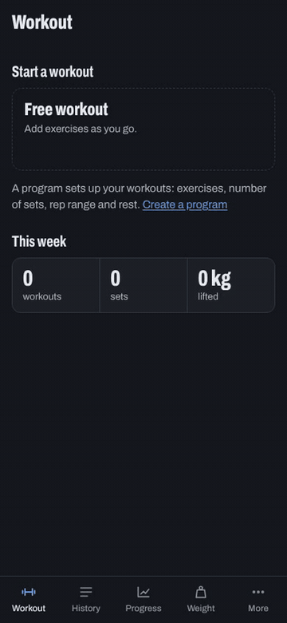
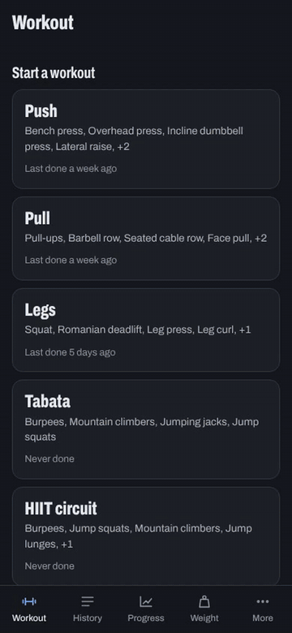
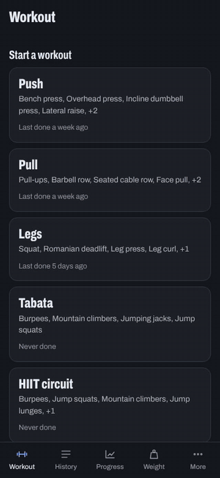
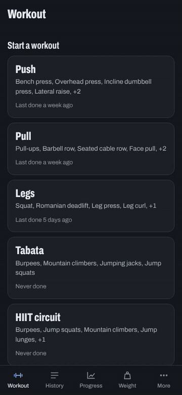
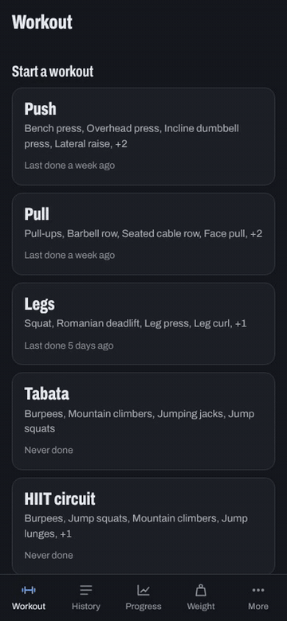

# Fonte: a strength training log

[Version française](README.md)

An installable web app (PWA) for phone, tablet and computer, in English and French. With it you can:

- start from **ready-made programs** (full body, 5×5, upper / lower, push / pull / legs, body-part split, bodyweight, HIIT Tabata, circuit, cardio, core) or build your own;
- log your **workouts** quickly, with last time's performance right next to each set;
- get a **weight suggestion** when every set reaches the top of the rep range (double progression);
- pick the **bar** for each exercise and see the **plates to load** on each side;
- get an automatic **rest timer** every time you check a set, and an **interval timer** for HIIT and core work;
- also track **cardio** (time, distance, pace) and **timed** exercises;
- spot your **PRs** (estimated 1RM, Epley formula);
- follow your **progress** per exercise and your **sets per muscle group**;
- log your **bodyweight**, with a 7-day average and a weekly trend;
- **sync** your devices, while still working **offline**.

Everyone who installs Fonte gets **their own copy** and **their own database**. Nobody else can access your data.

---

## What you need

- a [GitHub](https://github.com) account (free), to host the app;
- a [Supabase](https://supabase.com) account (free), for the database and sync;
- about 30 minutes, once. Nothing to install on your computer.

---

## Setup

### 1. Copy the repository

1. Sign in to GitHub and turn on two-factor authentication if you haven't already: **Settings > Password and authentication > Two-factor authentication**. Whoever controls your GitHub account can change your app.
2. On this repository's page, click **Fork** (top right), then **Create fork**. You can keep the name `fonte`.

### 2. Put your site online

1. In **your** repository (`YOUR-USERNAME/fonte`), go to **Settings > Pages**.
2. Source: **Deploy from a branch**; Branch: **main**, folder **/ (root)**, then **Save**.
3. Open the **Actions** tab. If it shows a message like "Workflows aren't being run on this forked repository", click the button to enable them. GitHub turns them off by default on forks.
4. After a minute or two, your site's address appears in **Settings > Pages**: `https://YOUR-USERNAME.github.io/fonte/`.

### 3. Create the database

1. On Supabase, click **New project**:
   - Name: `fonte`
   - Database password: generate one and keep it in your password manager (the app doesn't need it)
   - Region: the closest to you
2. Once the project is ready, open **SQL Editor**, click **New query**, paste the contents of `supabase/schema.sql` and click **Run**.
3. The result shows a 4-row table (`bodyweights`, `exercises`, `templates`, `workouts`). Check that each row says `rls_active = true` and `regles = 1`: the tables are created and protected.

If Supabase shows a **Potential issues detected** warning before running, you can confirm. The script doesn't delete any data: the only mentions of deletion are `on delete cascade` (your rows go away if your account is deleted) and the `delete` permission given to signed-in users on their own rows.

### 4. Create your account and close sign-ups

The app signs in with **email and password**. You create your account directly in Supabase: no email is sent.

1. In Supabase, open **Authentication > Users**, then **Add user > Create new user**.
2. Enter your email and a strong password (generate it with your password manager).
3. Check **Auto Confirm User**, then **Create user**.
4. Close sign-ups: **Authentication > Sign In / Providers**, turn off **Allow new users to sign up**, then **Save**. Your app's address is public: without this setting, anyone could create an account on your project.
5. In the same place, in the **Email** settings, require a minimum password length of at least 10 characters.

### 5. Connect the app to your database

1. Get from Supabase:
   - the **project URL**, which looks like `https://abcdefghijkl.supabase.co` (**Connect** button at the top of the dashboard, or **Project Settings > Data API**);
   - the **public key**: **Project Settings > API Keys**, the **Publishable** key (`sb_publishable_…`). If your project only shows the legacy keys, use the **anon** key.

   ⚠️ **Never** copy the `secret` or `service_role` key: it bypasses every security rule.
2. On GitHub, open the `config.js` file in **your** repository and click the pencil (**Edit this file**).
3. Replace the two values between the quotes. If the file already contains a URL and a key, they belong to whoever shared the repository with you: replace both.
   ```js
   window.FONTE_CONFIG = {
     supabaseUrl: 'https://abcdefghijkl.supabase.co',
     supabaseKey: 'sb_publishable_xxxxxxxxxxxx',
   };
   ```
   Keep the quotes and the comma at the end of each line.
4. Click **Commit changes**. The site updates within a minute or two.

### 6. Install the app on your devices

- **iPhone / iPad**: open your site's address in **Safari**, tap **Share**, then **Add to Home Screen**.
- **Android**: open the address in **Chrome**, menu **⋮**, then **Install app** (or **Add to Home screen**).
- **Computer**: in Chrome or Edge, click the install icon on the right of the address bar. A plain bookmark works too.

On each device, open **More > Account and sync** and sign in with the email and password from step 4. You stay signed in afterwards.

The badge at the top right shows the sync status: **Synced**, **Offline**, **Signed out**… If it says **On this device**, the app can't find your configuration: check `config.js` (step 5).

### Language

Fonte follows your device's language: French if your device is in French, English otherwise. To choose, go to **More > Settings > Language**. Catalog exercises and programs ("Bench press", "Push A"…) show in the chosen language, including ones you already created, without changing your data. Names you made up stay as they are.

---

## Tutorials

| Add a ready-made program | Log a workout | The HIIT timer |
|:---:|:---:|:---:|
|  |  |  |
| **Track your progress** | **Add your reference video** | |
|  |  | |

These videos are also in the app: **More > Help and tutorials**.

---

## Getting started

1. **More > Programs > Add a ready-made program**: pick a program from the catalog. Its workout templates and the exercises it needs are created for you, and you can change everything afterwards.
2. To build your own workouts: **More > Exercises** (the **Add common exercises** button gives you a starter list), then **More > Programs > New**. For each exercise, set the sets, the rep range (for example 8 to 12) and the rest.
3. **Workout**: tap a program to start. Last time's weights are pre-filled. Check ✓ each finished set: the rest timer starts.
4. During the workout, tap an **exercise name** to choose its starting load: a bar (Olympic, EZ, trap bar… or a custom weight), **bodyweight** (you then enter the added weight) or **no bar**. Your choice is kept for the next workouts.
5. Under each exercise name, **Watch the technique** runs a YouTube search for the exercise. When you find a video or short you want to use as a model, copy its link (**Share > Copy link**), then the exercise's **⋯** menu > **Add my reference video** > **Paste**. The link becomes **Watch my reference video**, on all your devices.
6. Tap a **set number** to mark it as a warm-up (left out of stats and PRs) or delete it.
7. **Timed exercises** (core, HIIT): tap **Start the timer**. It runs work and rest intervals with sound cues and checks the sets by itself. In a program, an exercise's **⋯** menu lets you **chain it into a circuit** with its neighbours: the timer then rotates between them, round after round.
8. **Cardio**: enter the time in minutes and the distance in km; the app works out pace and speed.
9. **Weight**: weigh yourself in the morning, before eating. Look at the 7-day average and the trend, not today's number.

---

## Updates

**Getting new versions of Fonte.** When the original repository changes, yours shows "This branch is X commits behind". Click **Sync fork**, then **Update branch**. Your `config.js` is kept.

**Updates that need an SQL script.** Some versions add a column to the database. The `supabase/` folder then contains a `migration-X.Y.sql` file: if you installed Fonte before that version, paste it into **SQL Editor** and click **Run** before doing **Sync fork**. A fresh install doesn't need it, `schema.sql` already has everything.

A conflict only happens if `config.js` was also changed in the original repository. If GitHub reports one, don't click **Discard commits**, because you'd lose your configuration: keep your own URL and key.

**On your devices**, the app checks for a new version every time it reopens and installs itself. During a workout, it offers **Update** without forcing anything. **More > Check for updates** forces the check. The installed version is shown at the bottom of the **More** screen.

---

## Sharing the app

- **Without an account**: just send your site's address. The app works without signing in, but data stays on that person's device (no sync).
- **With an account on your project**: create a user for them as in step 4 and give them a temporary password. They replace it in **More > Account and sync > Change password**. Security rules stop them from seeing your data in the app, and you from seeing theirs. From the Supabase dashboard, however, you can see their data: tell them.
- **Their own copy**: send them the repository link. They follow this guide and become fully independent.

---

## Backups

Supabase's free plan doesn't include automatic backups. Once a month, do **More > Backup > Export as JSON** and keep the file in your cloud storage. The same screen lets you import that file again and export your sets as CSV for a spreadsheet.

---

## Security

- **Your data is isolated**: row-level security (RLS) rules make sure each account only reads and writes its own data. A visitor who isn't signed in can't access anything.
- **Imported files are checked**: every field of a backup (or of data received from the server) is validated before it enters the app, and a Content Security Policy (CSP) blocks any script that doesn't come from the app itself. Still, only import backups you trust: they get added to your data.
- **The key in `config.js` is meant to be public.** Security relies on the RLS rules, not on keeping this key secret.
- **What matters is your GitHub and Supabase accounts**: protect them with a unique password and two-factor authentication.
- **A project's administrator can see all its data** from the Supabase dashboard. If you create accounts for other people, tell them.

---

## Troubleshooting

**The badge stays on "On this device".** The app can't read your configuration. Open `https://YOUR-USERNAME.github.io/fonte/config.js` in your browser: you should see your URL and key **between the quotes**, with a comma at the end of each line. Right after a change, wait up to 10 minutes for the cache to clear.

**"Wrong email or password".** Check the exact email in **Authentication > Users**. Don't delete the user to change the password: all their cloud data would be deleted with them. Use **Change password** in the app instead.

**"Account not confirmed".** The **Auto Confirm User** box wasn't checked. Delete the user (before there's any data) and create it again with the box checked.

**The badge says "Sync error".** Tap it to see the message. Usual causes: a typo in `config.js`, the SQL script not run, or the Supabase project paused.

**Supabase project paused.** Free projects are paused after a week without activity. The app keeps working on your devices. To restart the project: Supabase dashboard, open the project, **Resume project**. Pending changes then go out automatically.

**No sound on iPhone** (end of rest, interval timer). Sound only plays when the app is in the foreground and silent mode is off. The countdown stays accurate when you come back to the app: sets that ran out while you were away are checked.

---

## License

Fonte is under **[PolyForm Noncommercial 1.0.0](LICENSE)**. In short (only the `LICENSE` file is legally binding):

- ✅ **You can** use the app for free, for yourself, your family, your friends, a club, a school;
- ✅ **You can** copy it, change it and share your versions, as long as you keep the `LICENSE` file and the `Required Notice` line;
- ❌ **You can't** sell it, or use it in a paid product or service, without the author's permission;
- ⚠️ The app is provided **as is, with no warranty**. Adapt programs to your level and ask a professional if in doubt.

For commercial use, contact the author through their GitHub profile.

Third-party components (Supabase library, Archivo font) keep their own license: see [THIRD_PARTY_NOTICES.md](THIRD_PARTY_NOTICES.md).

## Contributing

An idea, a bug, an improvement? Everything is explained in [CONTRIBUTING.en.md](CONTRIBUTING.en.md): report a problem in the **Issues** tab, or suggest a change with a **Pull request**.

---

## For developers

### Changing the app

- After any change, bump the version number **in both places, with the same value**: `VERSION = 'fonte-vX.Y.Z'` at the top of `sw.js` and `APP_VERSION = 'X.Y.Z'` at the top of `js/app.js`. The app compares these two values to know whether an update is available.
- To test locally, double-clicking `index.html` doesn't work (browsers block JavaScript modules over `file://`). In the folder, run `python3 -m http.server 8000` and open `http://localhost:8000`.
- If you add a column to a table, add it to `supabase/schema.sql` **and** to that table's `columns` list in `js/store.js`.

### Code security

- Any text coming from data (names, notes…) goes through `esc()` before being inserted into a page.
- Any data entering the app (import, server, local storage) goes through `js/clean.js`. If you add a field, add it there too, with its type.
- The CSP is in `index.html`. It only allows connections to `*.supabase.co` addresses: if your Supabase project uses a custom domain, add it to `connect-src`.

### Translations

The French text is the key: in the code, `t('Séance')` shows "Workout" in English. Plurals use `tp(n, 'one', 'many')`, and parameters are written `{name}`. English translations live in `js/i18n-en.js`. If a key is missing, the app falls back to French and adds the key to `window.__i18nMissing` (handy to check from the browser console).

### Code layout

```
fonte/
├── LICENSE                 License (PolyForm Noncommercial 1.0.0)
├── CONTRIBUTING(.en).md    How to suggest an idea or a change
├── THIRD_PARTY_NOTICES.md  Third-party licenses
├── index.html              The app's single page
├── config.js               Supabase URL and public key
├── manifest.webmanifest    Name, icons, full-screen mode
├── sw.js                   Offline cache and updates
├── css/app.css             Styles (light, dark, phone, tablet, computer)
├── js/
│   ├── app.js              Navigation, rest timer, updates
│   ├── i18n.js             Language choice and translation functions
│   ├── i18n-en.js          English translations
│   ├── store.js            Local storage (IndexedDB)
│   ├── clean.js            Checks imported or received data
│   ├── sync.js             Supabase sync and sign-in
│   ├── calc.js             1RM, PRs, progression, bodyweight, plates
│   ├── charts.js           SVG charts
│   ├── timer.js            Interval timer (HIIT, core)
│   ├── presets.js          Ready-made program catalog
│   ├── ui.js               Sheets, menus, notifications
│   └── views/              One file per screen
├── supabase/schema.sql     Tables, sync and security rules
├── supabase/migration-*.sql  Database updates for existing installs
├── docs/tutos/             Video tutorials (French; English in docs/tutos/en/)
├── vendor/supabase.js      Supabase library, copied locally
├── fonts/                  Archivo font (OFL license)
└── icons/                  App icons
```

### How sync works

Each device saves everything locally first, then sends its changes and fetches the others': when the app opens, when it comes back to the foreground, a few seconds after each change and when the network returns. If two devices change the same item offline, the most recent change wins, on the device as on the server. Deletions are propagated. On the Supabase side, the RLS rule `user_id = auth.uid()` makes sure each account only reads and writes its own rows.
