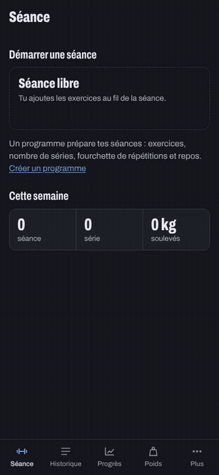
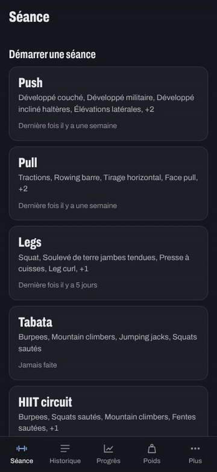
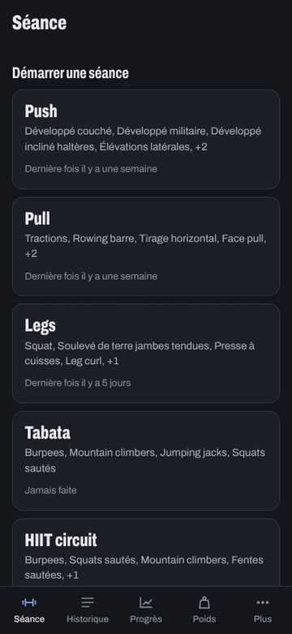
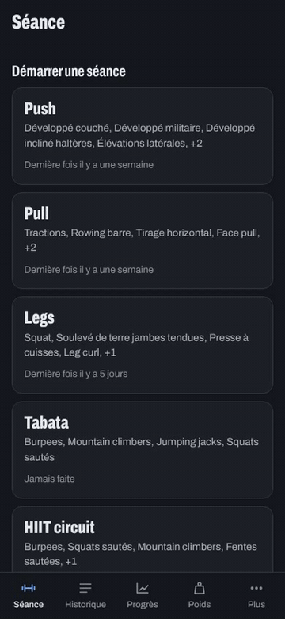
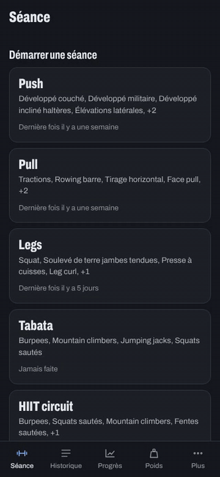

# Fonte : carnet de musculation

[English version](README.en.md)

Application web installable (PWA) pour téléphone, tablette et ordinateur, en français et en anglais. Elle permet de :

- partir de **programmes tout faits** (full body, 5×5, haut / bas, push / pull / legs, split, poids du corps, HIIT Tabata, circuit, cardio, gainage) ou créer les tiens ;
- saisir ses **séances** rapidement, avec les performances de la fois précédente en regard ;
- recevoir une **proposition de charge** quand toutes les séries atteignent le haut de la fourchette (double progression) ;
- choisir la **barre** de chaque exercice et voir les **disques à charger** de chaque côté ;
- lancer un **minuteur de repos** automatique à chaque série cochée, et un **minuteur d'intervalles** pour le HIIT et le gainage ;
- suivre aussi le **cardio** (durée, distance, allure) et les exercices **en durée** ;
- repérer les **records** (1RM estimé, formule d'Epley) ;
- suivre la **progression** par exercice et les **séries par groupe musculaire** ;
- s'**étirer** après la séance avec une routine guidée, adaptée aux muscles travaillés ;
- noter son **poids de corps**, avec moyenne sur 7 jours et tendance hebdomadaire ;
- **synchroniser** ses appareils, tout en continuant à fonctionner **hors connexion**.

Chaque personne qui installe Fonte a **sa propre copie** et **sa propre base de données**. Personne d'autre n'a accès à tes données.

---

## Ce qu'il te faut

- un compte [GitHub](https://github.com) (gratuit), pour héberger l'app ;
- un compte [Supabase](https://supabase.com) (gratuit), pour la base de données et la synchro ;
- environ 30 minutes, une seule fois. Rien à installer sur ton ordinateur.

---

## Installation

### 1. Copier le dépôt

1. Connecte-toi à GitHub et active la double authentification si ce n'est pas déjà fait : **Settings > Password and authentication > Two-factor authentication**. Quiconque contrôle ton compte GitHub peut modifier ton app.
2. Sur la page de ce dépôt, clique sur **Fork** (en haut à droite), puis sur **Create fork**. Tu peux garder le nom `fonte`.

### 2. Mettre ton site en ligne

1. Dans **ton** dépôt (`TON-PSEUDO/fonte`), va dans **Settings > Pages**.
2. Source : **Deploy from a branch** ; Branch : **main**, dossier **/ (root)**, puis **Save**.
3. Ouvre l'onglet **Actions**. S'il affiche un message du type « Workflows aren't being run on this forked repository », clique sur le bouton pour les activer. GitHub les désactive par défaut sur les copies de dépôt.
4. Après une ou deux minutes, l'adresse de ton site apparaît dans **Settings > Pages** : `https://TON-PSEUDO.github.io/fonte/`.

### 3. Créer la base de données

1. Sur Supabase, clique sur **New project** :
   - Nom : `fonte`
   - Mot de passe de la base : génère-le et garde-le dans ton gestionnaire de mots de passe (l'app n'en a pas besoin)
   - Région : la plus proche de chez toi
2. Une fois le projet prêt, ouvre **SQL Editor**, clique sur **New query**, colle le contenu du fichier `supabase/schema.sql` et clique sur **Run**.
3. Le résultat affiche un tableau de 4 lignes (`bodyweights`, `exercises`, `templates`, `workouts`). Vérifie que chacune indique `rls_active = true` et `regles = 1` : les tables sont créées et protégées.

Si Supabase affiche un avertissement **Potential issues detected** avant l'exécution, tu peux confirmer. Le script ne supprime aucune donnée : les seules mentions de suppression sont `on delete cascade` (tes lignes disparaissent si ton compte est supprimé) et le droit `delete` accordé aux utilisateurs connectés sur leurs propres lignes.

### 4. Créer ton compte et fermer les inscriptions

L'app se connecte par **email et mot de passe**. Tu crées ton compte directement dans Supabase : aucun email n'est envoyé.

1. Dans Supabase, ouvre **Authentication > Users**, puis **Add user > Create new user**.
2. Saisis ton email et un mot de passe solide (génère-le avec ton gestionnaire de mots de passe).
3. Coche **Auto Confirm User**, puis **Create user**.
4. Ferme les inscriptions : **Authentication > Sign In / Providers**, désactive **Allow new users to sign up**, puis **Save**. L'adresse de ton app est publique : sans ce réglage, n'importe qui pourrait créer un compte sur ton projet.
5. Au même endroit, dans les réglages **Email**, impose une longueur minimale de mot de passe d'au moins 10 caractères.

### 5. Relier l'app à ta base

1. Récupère dans Supabase :
   - l'**URL du projet**, de la forme `https://abcdefghijkl.supabase.co` (bouton **Connect** en haut du tableau de bord, ou **Project Settings > Data API**) ;
   - la **clé publique** : **Project Settings > API Keys**, clé **Publishable** (`sb_publishable_…`). Si ton projet n'affiche que les anciennes clés, prends la clé **anon**.

   ⚠️ Ne copie **jamais** la clé `secret` ou `service_role` : elle contourne toutes les règles de sécurité.
2. Sur GitHub, ouvre le fichier `config.js` de **ton** dépôt et clique sur le crayon (**Edit this file**).
3. Remplace les deux valeurs entre apostrophes. Si le fichier contient déjà une URL et une clé, ce sont celles de la personne qui t'a partagé le dépôt : remplace-les toutes les deux.
   ```js
   window.FONTE_CONFIG = {
     supabaseUrl: 'https://abcdefghijkl.supabase.co',
     supabaseKey: 'sb_publishable_xxxxxxxxxxxx',
   };
   ```
   Garde bien les apostrophes et la virgule en fin de ligne.
4. Clique sur **Commit changes**. Le site se met à jour en une à deux minutes.

### 6. Installer l'app sur tes appareils

- **iPhone / iPad** : ouvre l'adresse de ton site dans **Safari**, touche **Partager**, puis **Sur l'écran d'accueil**.
- **Android** : ouvre l'adresse dans **Chrome**, menu **⋮**, puis **Installer l'application** (ou **Ajouter à l'écran d'accueil**).
- **Ordinateur** : dans Chrome ou Edge, clique sur l'icône d'installation à droite de la barre d'adresse. Un simple favori fonctionne aussi.

Sur chaque appareil, ouvre **Plus > Compte et synchronisation** et connecte-toi avec l'email et le mot de passe de l'étape 4. La connexion reste active ensuite.

La pastille en haut à droite indique l'état de la synchro : **Synchronisé**, **Hors ligne**, **Non connecté**… Si elle affiche **Sur cet appareil**, l'app ne trouve pas ta configuration : vérifie `config.js` (étape 5).

### Langue

Fonte suit la langue de ton appareil : français si l'appareil est en français, anglais sinon. Pour choisir, va dans **Plus > Réglages > Langue**. Les exercices et programmes du catalogue (« Développé couché », « Push A »…) s'affichent dans la langue choisie, même ceux déjà créés, sans modifier tes données. Les noms que tu as inventés restent tels quels.

---

## Tutoriels

| Ajouter un programme tout fait | Faire une séance | Le minuteur HIIT |
|:---:|:---:|:---:|
|  |  |  |
| **Suivre sa progression** | **Ajouter ta vidéo de référence** | |
|  |  | |

Ces vidéos sont aussi dans l'app : **Plus > Aide et tutoriels**.

---

## Premiers pas

1. **Plus > Programmes > Ajouter un programme tout fait** : choisis un programme du catalogue. Ses séances types et les exercices nécessaires sont créés pour toi, et tu peux tout modifier ensuite.
2. Pour composer tes propres séances : **Plus > Programmes > Nouveau**. Quand tu choisis un exercice, tes exercices et tout le catalogue sont proposés. Pour chaque exercice, indique les séries, la fourchette de répétitions (par exemple 8 à 12) et le repos.
3. **Séance** : l'onglet **Programmes** liste tes séances types, touche-en une pour démarrer (son menu **⋯** permet aussi de la retirer). L'onglet **Exercices** démarre une séance avec un ou plusieurs exercices choisis. Les charges de la dernière fois sont pré-remplies. Coche ✓ chaque série terminée : le minuteur de repos démarre. La flèche **Retour** garde la séance pour plus tard ; **Annuler la séance** la supprime sans rien enregistrer.
   Pour les exercices à la barre, saisis la **charge totale, barre comprise** : l'app n'ajoute pas le poids de la barre.
4. Pendant la séance, touche le **nom d'un exercice** pour choisir sa charge de départ : une barre (olympique, EZ, trap bar… ou un poids personnalisé), le **poids du corps** (tu saisis alors le lest) ou **sans barre**. Le choix est retenu pour les séances suivantes.
5. Sous le nom de chaque exercice, **Voir la technique** lance une recherche YouTube sur l'exercice. Quand tu trouves une vidéo ou un short qui te sert de modèle, copie son lien (**Partager > Copier le lien**), puis menu **⋯** de l'exercice > **Ajouter ma vidéo de référence** > **Coller**. Le lien devient **Voir ma vidéo de référence**, sur tous tes appareils.
6. Touche le **numéro d'une série** pour la marquer comme échauffement (exclue des statistiques et des records) ou la supprimer.
7. **Exercices en durée** (gainage, HIIT) : touche **Lancer le minuteur**. Il enchaîne efforts et récups avec des signaux sonores et coche les séries tout seul. Dans un programme, le menu **⋯** d'un exercice permet de l'**enchaîner en circuit** avec ses voisins : le minuteur tourne alors entre eux, tour après tour.
8. **Cardio** : saisis la durée en minutes et la distance en km ; l'app calcule l'allure et la vitesse.
9. **Étirements** : à la fin d'une séance, l'écran récapitulatif propose une routine adaptée (30 secondes par étirement, de chaque côté si besoin). Tu la retrouves aussi dans **Plus > Étirements**.
10. **Poids** : pèse-toi le matin, à jeun. Regarde la moyenne 7 jours et la tendance, pas la pesée du jour.

---

## Mises à jour

**Récupérer les nouvelles versions de Fonte.** Quand le dépôt d'origine évolue, ton dépôt affiche « This branch is X commits behind ». Clique sur **Sync fork**, puis **Update branch**. Ton `config.js` est conservé.

**Mises à jour qui demandent un script SQL.** Certaines versions ajoutent une colonne à la base. Le dossier `supabase/` contient alors un fichier `migration-X.Y.sql` : si tu avais installé Fonte avant cette version, colle-le dans **SQL Editor** et clique sur **Run** avant de faire **Sync fork**. Une nouvelle installation n'en a pas besoin, `schema.sql` contient déjà tout.

Un conflit n'arrive que si `config.js` a aussi été modifié dans le dépôt d'origine. Si GitHub en signale un, ne clique pas sur **Discard commits**, car tu perdrais ta configuration : garde tes propres valeurs d'URL et de clé.

**Sur tes appareils**, l'app vérifie s'il y a une nouvelle version à chaque réouverture et s'installe toute seule. Pendant une séance, elle propose **Mettre à jour** sans rien forcer. Le bouton **Plus > Rechercher une mise à jour** force la vérification. La version installée est affichée en bas de l'écran **Plus**.

---

## Partager l'app

- **Sans compte** : envoie simplement l'adresse de ton site. L'app fonctionne sans connexion, mais les données restent sur l'appareil de la personne (pas de synchro).
- **Avec un compte sur ton projet** : crée-lui un utilisateur comme à l'étape 4 et transmets-lui un mot de passe provisoire. Elle le remplace dans **Plus > Compte et synchronisation > Changer le mot de passe**. Les règles de sécurité l'empêchent de voir tes données, et toi les siennes depuis l'app. Depuis le tableau de bord Supabase, en revanche, tu peux voir ses données : préviens-la.
- **Sa propre copie** : envoie-lui le lien du dépôt. Elle suit ce guide et devient totalement indépendante.

---

## Sauvegardes

L'offre gratuite de Supabase n'inclut pas de sauvegarde automatique. Une fois par mois, fais **Plus > Sauvegarde > Exporter en JSON** et range le fichier dans ton stockage en ligne. Le même écran permet de réimporter ce fichier et d'exporter tes séries en CSV pour un tableur.

---

## Sécurité

- **Tes données sont isolées** : des règles de sécurité au niveau des lignes (RLS) garantissent que chaque compte ne lit et n'écrit que ses propres données. Un visiteur non connecté n'a accès à rien.
- **Les fichiers importés sont contrôlés** : chaque champ d'une sauvegarde (ou reçu du serveur) est vérifié avant d'entrer dans l'app, et une politique de sécurité du contenu (CSP) bloque tout script qui ne vient pas de l'app elle-même. Importe malgré tout uniquement des sauvegardes dont tu connais la provenance : elles s'ajoutent à tes données.
- **La clé dans `config.js` est faite pour être publique.** La sécurité repose sur les règles RLS, pas sur le secret de cette clé.
- **Le point sensible, ce sont tes comptes GitHub et Supabase** : protège-les avec un mot de passe unique et la double authentification.
- **L'administrateur d'un projet voit toutes ses données** depuis le tableau de bord Supabase. Si tu crées des comptes pour d'autres personnes, préviens-les.

---

## Problèmes fréquents

**La pastille reste sur « Sur cet appareil ».** L'app ne lit pas ta configuration. Ouvre `https://TON-PSEUDO.github.io/fonte/config.js` dans ton navigateur : tu dois y voir ton URL et ta clé **entre les apostrophes**, avec une virgule à la fin de chaque ligne. Juste après une modification, attends jusqu'à 10 minutes que le cache se vide.

**« Email ou mot de passe incorrect ».** Vérifie l'email exact dans **Authentication > Users**. Ne supprime pas l'utilisateur pour changer de mot de passe : toutes ses données dans le cloud seraient effacées avec lui. Utilise plutôt **Changer le mot de passe** dans l'app.

**« Compte non confirmé ».** La case **Auto Confirm User** n'était pas cochée. Supprime l'utilisateur (avant d'avoir des données) et recrée-le en la cochant.

**La pastille indique « Erreur de synchro ».** Touche-la pour voir le message. Les causes habituelles : une faute dans `config.js`, le script SQL non exécuté, ou le projet Supabase en pause.

**Projet Supabase en pause.** Les projets gratuits sont mis en pause après une semaine sans activité. L'app continue de fonctionner sur tes appareils. Pour relancer le projet : tableau de bord Supabase, ouvre le projet, **Resume project**. Les modifications en attente partent ensuite automatiquement.

**Le son ne joue pas sur iPhone** (fin de repos, minuteur d'intervalles). Le son ne joue que si l'app est au premier plan et le mode silencieux désactivé. Le décompte reste juste quand tu reviens dans l'app : les séries écoulées pendant ton absence sont cochées.

---

## Licence

Fonte est sous **[PolyForm Noncommercial 1.0.0](LICENSE)**. En résumé (seul le texte anglais du fichier `LICENSE` fait foi) :

- ✅ **Tu peux** utiliser l'app gratuitement, pour toi, ta famille, tes amis, une association, une école ;
- ✅ **Tu peux** la copier, la modifier et partager tes versions, à condition de garder le fichier `LICENSE` et la mention `Required Notice` ;
- ❌ **Tu ne peux pas** la vendre, ni l'utiliser dans un produit ou un service payant, sans l'accord de l'auteur ;
- ⚠️ L'app est fournie **telle quelle, sans garantie**. Adapte les programmes à ton niveau et demande conseil à un professionnel en cas de doute.

Pour un usage commercial, contacte l'auteur via son profil GitHub.

Les composants tiers (bibliothèque Supabase, police Archivo) gardent leur propre licence : voir [THIRD_PARTY_NOTICES.md](THIRD_PARTY_NOTICES.md).

## Contribuer

Une idée, un bug, une amélioration ? Tout est expliqué dans [CONTRIBUTING.md](CONTRIBUTING.md) ([in English](CONTRIBUTING.en.md)) : signaler un problème dans l'onglet **Issues**, ou proposer une modification avec une **Pull request**.

---

## Pour les développeurs

### Modifier l'app

- Après toute modification, augmente le numéro de version **aux deux endroits, avec la même valeur** : `VERSION = 'fonte-vX.Y.Z'` en haut de `sw.js` et `APP_VERSION = 'X.Y.Z'` en haut de `js/app.js`. L'app compare ces deux valeurs pour savoir si une mise à jour est disponible.
- Pour tester en local, ouvrir `index.html` en double-cliquant ne fonctionne pas (les navigateurs bloquent les modules JavaScript en `file://`). Dans le dossier, lance `python3 -m http.server 8000` et ouvre `http://localhost:8000`.
- Si tu ajoutes une colonne à une table, ajoute-la dans `supabase/schema.sql` **et** dans la liste `columns` de la table dans `js/store.js`.

### Sécurité du code

- Tout texte venant des données (noms, notes…) passe par `esc()` avant d'être inséré dans une page.
- Toute donnée qui entre dans l'app (import, serveur, stockage local) passe par `js/clean.js`. Si tu ajoutes un champ, ajoute-le aussi là, avec son type.
- La CSP est dans `index.html`. Elle n'autorise la connexion qu'aux adresses `*.supabase.co` : si ton projet Supabase utilise un domaine personnalisé, ajoute-le dans `connect-src`.

### Traductions

Le texte français sert de clé : dans le code, `t('Séance')` affiche « Workout » en anglais. Les pluriels passent par `tp(n, 'un', 'plusieurs')`, et les paramètres s'écrivent `{nom}`. Les traductions anglaises sont dans `js/i18n-en.js`. Si une clé manque, l'app affiche le français et ajoute la clé à `window.__i18nMissing` (pratique à vérifier depuis la console du navigateur). Pense aussi à mettre à jour `README.en.md` quand tu modifies ce guide.

### Organisation du code

```
fonte/
├── LICENSE                 Licence (PolyForm Noncommercial 1.0.0)
├── README.en.md           Ce guide, en anglais
├── CONTRIBUTING(.en).md    Comment proposer une idée ou une modification
├── THIRD_PARTY_NOTICES.md  Licences des composants tiers
├── index.html              Page unique de l'app
├── config.js               URL et clé publique Supabase
├── manifest.webmanifest    Nom, icônes, mode plein écran
├── sw.js                   Cache hors ligne et mises à jour
├── css/app.css             Styles (clair, sombre, mobile, tablette, ordinateur)
├── js/
│   ├── app.js              Navigation, minuteur de repos, mises à jour
│   ├── i18n.js             Choix de la langue et fonctions de traduction
│   ├── i18n-en.js          Traductions anglaises
│   ├── store.js            Stockage local (IndexedDB)
│   ├── clean.js            Contrôle des données importées ou reçues
│   ├── sync.js             Synchronisation et connexion Supabase
│   ├── calc.js             1RM, records, progression, poids de corps, disques
│   ├── charts.js           Graphiques SVG
│   ├── timer.js            Minuteur d'intervalles (HIIT, gainage)
│   ├── presets.js          Catalogue de programmes tout faits
│   ├── stretch.js          Étirements : routines et déroulé guidé
│   ├── ui.js               Feuilles, menus, notifications
│   └── views/              Un fichier par écran
├── supabase/schema.sql     Tables, synchro et règles de sécurité
├── supabase/migration-*.sql  Mises à jour de la base pour les installations existantes
├── docs/tutos/             Tutoriels vidéo (MP4 pour l'app, GIF pour ce guide ; anglais dans docs/tutos/en/)
├── vendor/supabase.js      Bibliothèque Supabase, copiée localement
├── fonts/                  Police Archivo (licence OFL)
└── icons/                  Icônes de l'app
```

### Fonctionnement de la synchro

Chaque appareil enregistre d'abord tout en local, puis envoie ses modifications et récupère celles des autres : à l'ouverture, au retour au premier plan, quelques secondes après chaque modification et au retour du réseau. Si deux appareils modifient le même élément hors connexion, la modification la plus récente l'emporte, côté appareil comme côté serveur. Les suppressions sont propagées. Côté Supabase, la règle RLS `user_id = auth.uid()` garantit que chaque compte ne lit et n'écrit que ses propres lignes.
